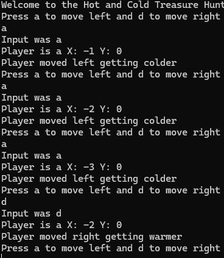
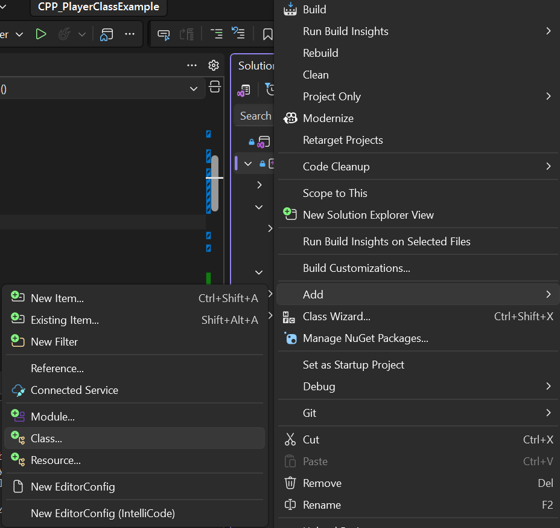
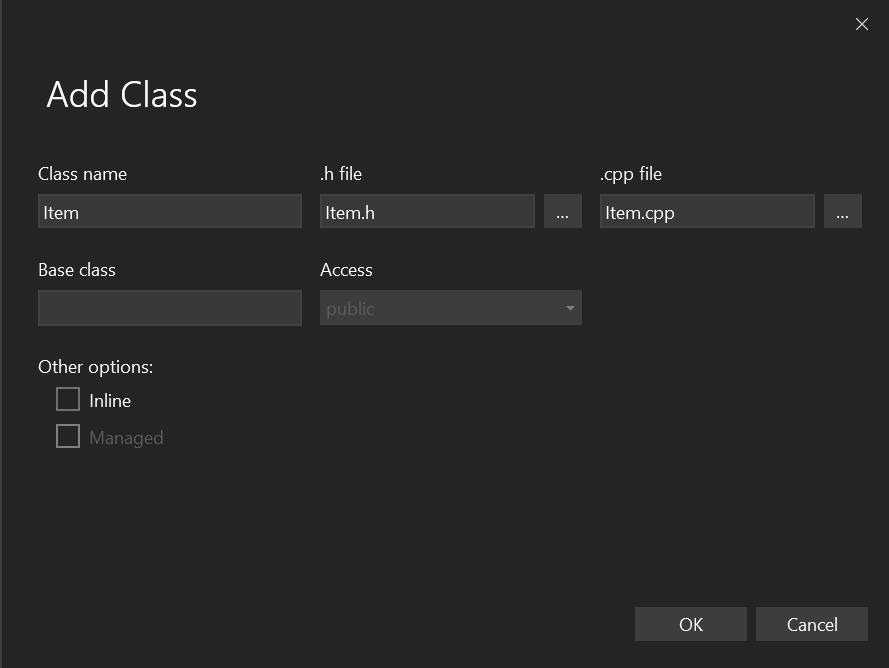

# CPP_PlayerClassExample

An example C++ program for taking existing OO knowledge and transferring it into the C++ style.

## Overview

[A video overview is here](https://mmutube.mmu.ac.uk/media/Intro+to+the+Hot+and+Cold+Game/1_wcknm7p0). In this we will work on a basic Hot and Cold style game mechanic, each "turn" the player will use WASD to move in a direction and the player will be told if they are hotter or colder. The goal is to understand the basics of a C++ project compared to a C# project.

Hot and Cold games are quite common for children and appear as way to find areas/ objects of interest, a nice version of this game is the [Chocobo Hot & Cold mini game in Final Fantasy IX](https://www.youtube.com/watch?v=3M0hIkWmbuA)

## Task

### Namespaces

In the **CPP_PlayerClassExample.cpp** file:

First let's recap namespaces, we covered this in C#, they act as a container to group multiple related classes together. This is useful as it also allows large projects to have the same class name, but under different namespaces, e.g. if you used Random in C# Unity you will get a warning about multiple [Random Classes](https://unity.huh.how/compiler-errors/cs0104.html).

At the start, to show you `::`, I didn't use it, but as we are going to be printing let's use the std namespace, **under #include Player.h** add the line:

```cpp
using namespace std;
```

This means in the code, if possible, commands will auto use the std library, which means we can change:

```cpp
std::cout << "Welcome to the Hot and Cold Treasure Hunt\n";
```

to

```cpp
cout << "Welcome to the Hot and Cold Treasure Hunt\n";
```

Now we are using that namespace we can save a bit of typing.

### Console input

You can see I have already created a basic gameplay loop via a **while(true)**. We will be taking in input from the user in this loop. But first good practice is to prompt the user, using [cout](https://www.geeksforgeeks.org/cpp/cout-in-c/), in the loop i have added this line:

```cpp
cout << "Press a to move left or d to move right\n";
```

Now since we know that **cout** is **console out**, naturally [**cin**](https://www.geeksforgeeks.org/cpp/cin-in-c/) is **console in**. But this does pose an issue, we can get direct characters with [cin.get](https://www.geeksforgeeks.org/cpp/cin-get-in-c-with-examples/), but that is more prone to errors. For us we will use the basic cin string, but in **C++ we don't have a String by default**, but it is given through the **std namespace**. To do this we need a variable to store the input and then in the loop to update it:

Before the loop, we have the storage:

```cpp
string input;
```

During the loop we prompt:

```cpp
cin >> input;
cout << "Input was " << input << "\n";
```

Compile and try out the input system.

### Moving left or right

Now that we have input, You **can begin adding code, [watch me here](https://mmutube.mmu.ac.uk/media/HotCold+Task+Base/1_amwf6oiw)** we can begin to affect the player's position, use this code to move the player:

```cpp
if (input[0] == 'a')
{
    p.Move(-1, 0);
    cout << "Player moved left getting colder\n";
}
else if (input[0] == 'd')
{
    p.Move(1, 0);
    cout << "Player moved right getting warmer\n";
}
```

Now currently this should tell us the player is moving however, it would be nicer to see if the player is updating their movement, in the **Player.h** file, you see I have **defined a PrintPos**, but in **Player.cpp** I haven't implemented it. Let's do that now add this block of code to **Player.cpp**:

```cpp
void Player::PrintPos()
{
    std::cout << "Player is at X: " << x << " Y: " << y << "\n";
}
```

Because you are outputting you will also need to add this to the top of **Player.cpp**:

```cpp
#include <iostream>
```

To test it is working I added a call to the function in the **Move** function, the output should look like:



Try to work through the Challenges and ask for help if you get stuck.

## Challenges

Test your might

### Easy

- Expand the code to move up and down

  Hint: use the code in **CPP_PlayerClassExample.cpp**, where you do the **input[0] == 'd'**. [Watch me here](https://mmutube.mmu.ac.uk/media/Hot++Cold+Challenge+1/1_7wte0lxz)

- Expand the code to restrict the player's position within a grid of 10 * 10

  Hint: I would define a **bool CanMove(int xDir, int yDir);** in **Player.h** and implement it in **Player.cpp**, that way in the input checking you can do **&& CanMove()**. You could also either pass in the bounds or hard code them. [Watch me here](https://mmutube.mmu.ac.uk/media/Hot++Cold+Challenge+2/1_7mwxybtk)

- Ensure you provide feedback on what the player has done and what you want them to do e.g. ask for input, and add error checking to inputs

  Make sure the messages are clear on where the player has moved to, if they have hit the boundary, typed the wrong input or gave no input. For the case management you can use [toLower](https://www.geeksforgeeks.org/cpp/tolower-function-in-cpp/) and you can check the length of a string [size](https://www.geeksforgeeks.org/cpp/5-different-methods-to-find-length-of-a-string-in-cpp/).

### Medium

- Right click the project (**CPP_PlayerClassExample**, just under the solution) and choose **Add -> Class...** to make a new class called Item

  

  

  Give it an **x** and **y** like the Player. To use it in the **CPP_PlayerClassExample.cpp** you need to include the Header file, and **try not to use the new** keyword until we have gone through pointers, a normal variable is all we need:

  ```cpp
  Item item;
  ```

  Make the item **before** the **while** loop, if you make it inside the loop you get a brand new item every turn. While you are testing, print where the item is so you can check your code, just remember to remove it later.

- Give Item a constructor to pass a position and a default that chooses a random (10*10) position.

  The constructor, just like in C#, is a function with no return value like so:

  ```cpp
  Item();
  Item(int StartX, int StartY);
  ```

  In **Item.cpp** we implement it the same way as the Player's functions, with **Item::** in front, but still no return type:

  ```cpp
  Item::Item(int StartX, int StartY)
  {
      x = StartX;
      y = StartY;
  }
  ```

  After implementing in **Item.cpp**, you can create with the second constructor just using:

  ```cpp
  Item i(1, 2);
  ```

  **Careful**, for the default (random) constructor use **no brackets**, `Item i;` and **not** `Item i();`. C++ reads `Item i();` as declaring a function called i, so you get a confusing error the first time you try to use `i.x`.

  For the random element of the task you can use the [Random](https://www.geeksforgeeks.org/cpp/how-to-generate-random-value-by-dice-roll-in-cpp/), note this seems complex but it's because it's using the time to set our random seed. Two things to watch:

  - The dice example adds 1 to get 1 to 6, our grid from the Easy task is 0 to 9, so you want `rand() % 10` with no + 1
  - Only call `srand` **once**, at the start of **main**, not in the constructor, otherwise items made in the same second land on the same square

- Expand so if the player gets closer to the item the system will print warmer, or if further away colder, rather than just by moving closer to the item.

  As we are grid movement I would recommend the [Manhattan](https://www.geeksforgeeks.org/data-science/manhattan-distance/) distance, the number of moves to the item, you only need **abs** from `#include <cstdlib>` and it stays as whole numbers. The [Euclidean](https://en.wikipedia.org/wiki/Euclidean_distance) distance also works, but you need **sqrt** from the C++ Math library [**#include &lt;cmath&gt;**](https://www.geeksforgeeks.org/cpp/c-mathematical-functions/) and should store it as a float.

  You can store the last distance to know if you are Hotter or Colder, plan it out like this:

  1. Before the loop, work out the starting distance and store it
  2. After each move, work out the new distance
  3. Compare the two, print warmer or colder
  4. Save the new distance as the last distance, ready for the next turn

  Remember to remove the old "getting warmer/colder" messages from the main task, they were never checking the item.

### Hard

- Make it so if the player hits the item, it prints you found the item! +100 and moves the item to a new location, and stores the score
- Restrict the player to a number of moves they can make before the game ends, they will get some bonus moves for collecting an item
- Add another class called Wall, at the start a number of walls will be added, then each time an item is collected more will spawn. If the player tries to move where a wall is they will lose the move and the message "A wall blocks your path, Should have gone to specsavers"

### Refinements

Part of the assignment and purpose of this module is to show you can refine the gameplay to a high standard.

- Instead of just warmer and colder, also add context, such as "warmer, still cool", to show the player is closer but still far away. If you really want to go all out, individual words are tricky but with the [**System(Color 0E);**](https://www.geeksforgeeks.org/cpp/how-to-print-colored-text-in-c/) command you can change the console text (E for text, 0 for background)
- See if you can make use of the Carriage return "\r", to actually keep the console window short and keep information like moves left and total score available.
- Add a new refinement to the game of your own choosing

### Coding Practices

- See about making either a standard movement class or IMoveable interface for the classes you have created for a more component based system.
- See if you can make a Gameplay Manager that handles score, number of moves left and gamestate
# Reference
Content is made by Connah Kendrick (Connah.Kendrick@mmu.ac.uk)
